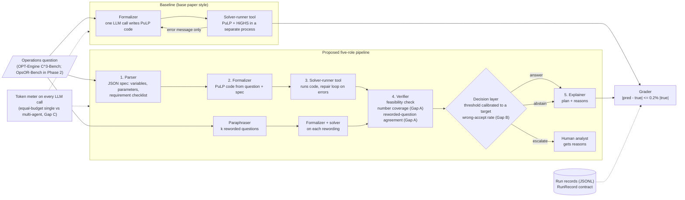

# System architecture

## Overview

The system turns an operations question written in plain language into an optimization model, solves it,
checks the model, and then either answers, abstains or escalates to a human with stated reasons.

## Baseline vs proposed system

| | Baseline | Proposed pipeline |
|---|---|---|
| LLM roles | One formalizer call (plus optional repair calls) | Parser, formalizer, paraphraser; solver-runner and explainer are tools/code |
| What is checked | Code runs and the solver finishes | Feasibility, every number in the question is used, rewordings reach the same optimum |
| Output | Always gives a number | Answer, abstain or escalate, with reasons |
| Repair feedback | Solver or runtime error text only | Same (the reference answer is never shown to any role) |

## Where each research gap is handled

| Gap | Component | Status |
|---|---|---|
| A. Verifiers do not check requirement-level coverage or invariance to rewording | `optverify/verifier.py`: `number_coverage`, `paraphrase_agreement` | Implemented (Phase 1) |
| B. Refusal rules have no error-rate guarantee that holds on new problem classes | `optverify/verifier.py`: `decide` threshold | Fixed placeholder threshold now; calibrated threshold with leave-one-class-out tests in Phase 2 |
| C. No equal-token-budget comparison of single vs multi-agent designs | `TokenUsage` on every call (`optverify/contracts.py`) | Token metering implemented; single-agent variant in Phase 2 |

## State and contracts

All stages exchange the dataclasses in `optverify/contracts.py`:

- `Problem`: question, reference optimum, class, size, split
- `Attempt` and `SolveResult`: generated code, solver status, objective, error text, runtime
- `VerifierReport`: feasibility, number coverage, missing numbers, reworded-run objectives, score
- `Decision`: action (answer, abstain, escalate), answer, reasons
- `RunRecord`: everything above plus token usage and latency; saved one per line in `results/<run>/records.jsonl`

## Tools and external systems

- **LLM providers** (`optverify/llm.py`): any OpenAI-compatible endpoint (free tiers: Groq, OpenRouter, Google AI Studio, local Ollama) or Amazon Bedrock. Requests are spaced with `LLM_MAX_RPM` to respect free-tier limits.
- **Solver-runner** (`optverify/solver_tool.py`): runs the generated script with PuLP + HiGHS in a separate Python process with a time limit and a minimal environment (no API keys visible).
- **Data** (`scripts/download_data.py`): OPT-Engine C^3-Bench, pinned to one upstream commit.

## Human controls

- Escalated cases go to a human with the reasons (missing numbers, disagreeing rewordings).
- The threshold for answering is a single setting (`--threshold`), so the operator chooses the trade-off between coverage and risk.
