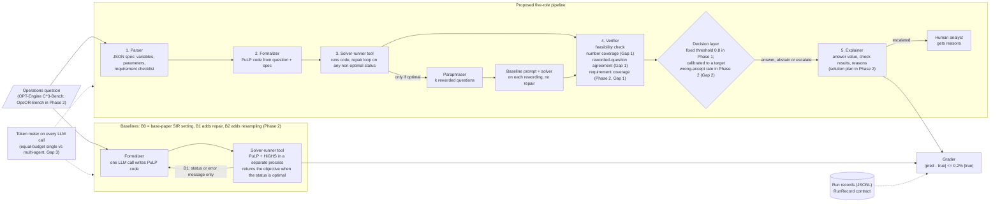

# System architecture

## Overview

The system turns an operations question written in plain language into an optimization model, solves it,
checks the model, and then either answers, abstains or escalates to a human with stated reasons.

## Baseline vs proposed system

| | Baseline | Proposed pipeline |
|---|---|---|
| LLM roles | One formalizer call (plus optional repair calls) | Parser, formalizer, paraphraser; solver-runner and explainer are tools/code |
| What is checked | Nothing beyond running the code | Feasibility, every number in the question is used, rewordings reach the same optimum (requirement coverage added in Phase 2) |
| Output | The objective whenever the solver status is optimal; never abstains | Answer, abstain or escalate, with reasons |
| Repair feedback | Solver or runtime error text only | Same (the reference answer is never shown to any role) |

## Where each research gap is handled

| Gap | Component | Status |
|---|---|---|
| Gap 1. Verifiers do not check requirement-level coverage or invariance to rewording | `optverify/verifier.py`: `number_coverage`, `paraphrase_agreement` | Implemented (Phase 1). Phase 2 so far: number coverage ignores item labels such as "Package 3", accepts percentages written as fractions and reads commas in code as separators between values; a failed paraphrase run is retried once and, if it still fails, left out of the agreement. Requirement coverage (each parser requirement linked to a named constraint) still to come |
| Gap 2. Refusal rules have no error-rate guarantee that holds on new problem classes | `optverify/verifier.py`: `decide` threshold | Fixed placeholder threshold now; calibrated threshold with leave-one-class-out tests in Phase 2 |
| Gap 3. No equal-token-budget comparison of single vs multi-agent designs | `TokenUsage` on every call (`optverify/contracts.py`), `usage_by_step` per record; `optverify/systems.py`: `run_single_agent` (B2) | Token metering per step, the single-agent variant B2 and the E3 analysis (`scripts/analyze_e3.py`) implemented (Phase 2) |

## State and contracts

All stages exchange the dataclasses in `optverify/contracts.py`:

- `Problem`: question, reference optimum, class, size, split
- `Attempt` and `SolveResult`: generated code, solver status, objective, error text, runtime
- `VerifierReport`: feasibility, number coverage, missing numbers, paraphrase agreement, reworded-run objectives, score
- `Decision`: action (answer, abstain, escalate), answer, reasons
- `RunRecord`: problem identifiers and reference answer, attempts (each with its solve result), parser specification, verifier report, decision, explanation, token usage and latency; saved one per line in `results/<run>/records.jsonl`
- `RunRecord.usage_by_step`: token use of each step (`parse`, `formalize`, `repair`, and `paraphrase_1` ... `paraphrase_k`, each covering that run's paraphraser and formalizer calls, including the one retry of a failed run); the steps add up to `usage`. Records saved before Phase 2 have no steps
- B2 records also have `samples` (the attempts of each sample; sample 1 is B1 and is also stored in `attempts`), `token_budget` and `sample_agreement` (B2's score); each sample's tokens are in `usage_by_step["sample_<i>"]`
- B2 answers with the first `samples_used` samples (the ones whose tokens are closest to the budget), and `usage` counts only those samples; any sample drawn after them stays in `samples` and `usage_by_step`

## Tools and external systems

- **LLM providers** (`optverify/llm.py`): Amazon Bedrock is the main provider (`gpt-oss-120b`), or any OpenAI-compatible endpoint (free tiers: Groq, OpenRouter, Google AI Studio, local Ollama). Requests to OpenAI-compatible endpoints are spaced with `LLM_MAX_RPM` to respect free-tier limits. A request rejected as larger than the per-minute token limit (error 413) is sent once more with its output cap fitted to the limit (`fitted_output_cap`).
- **Solver-runner** (`optverify/solver_tool.py`): runs the generated script with PuLP + HiGHS in a separate Python process with a time limit and a minimal environment (no API keys visible).
- **Data** (`scripts/download_data.py`): OPT-Engine C^3-Bench, pinned to one upstream commit.

## Human controls

- Escalated cases go to a human with the reasons (missing numbers, disagreeing rewordings).
- The threshold for answering is a single setting (`--threshold`), so the operator chooses the trade-off between coverage and risk.
